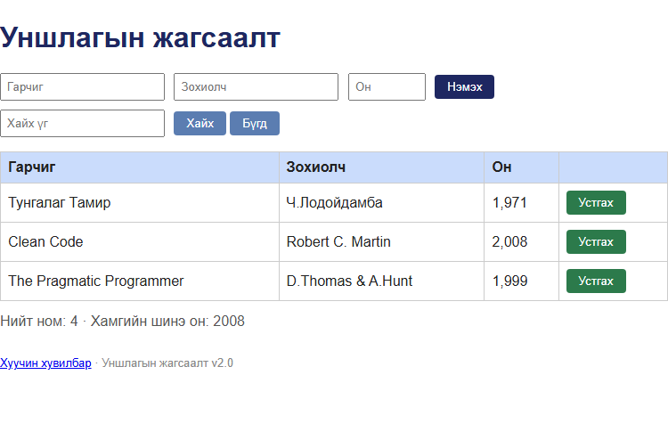
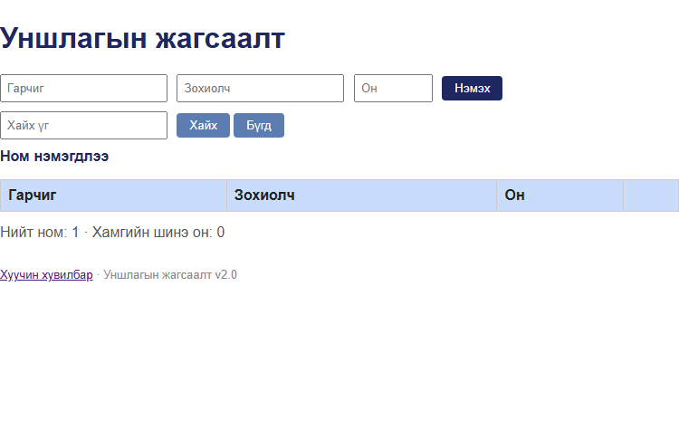

# BUG-01: Нийт номын тоолуур гурван мөрийг дөрөв гэж харуулдаг

**Орчин** Уншлагын жагсаалт v2.0, Microsoft Edge 158.0.4370.33, Windows 11, 2026-11-25.

**Урьдчилсан нөхцөл** `node app.js`-ийг шинээр асаасан, жагсаалт анхны 3 номтой.

## Дахин гаргах алхам

1. Браузераар `http://localhost:3000` хаягийг нээнэ.
2. Хайлтын талбарыг хоосон хэвээр орхиод хүснэгтийн номын мөрүүдийг тоолно.
3. Мөрийн тоог хүснэгтийн доорх «Нийт ном» утгатай тулгана.

**Хүлээгдэж байсан** Хүснэгтэд байгаа гурван номын хувьд «Нийт ном: 3» гэж харагдана.

**Бодит үр дүн** «Тунгалаг Тамир», «Clean Code», «The Pragmatic Programmer» гэсэн 3 мөр харагдсан. Доор нь «Нийт ном: 4» гэж байв.

**Ноцтой байдал** Minor. Жагсаалт өөрөө нээгдэж байгаа ч хэрэглэгчийн харж буй тоо номын бодит тоотой зөрнө.

**Олдсон аялал** Supermodel

Session-д мөрүүдийг нэг нэгээр устгаад хоосон хүснэгтэд хүрэхэд «Нийт ном: 1» гэж харагдсан.

## Хавсралт

