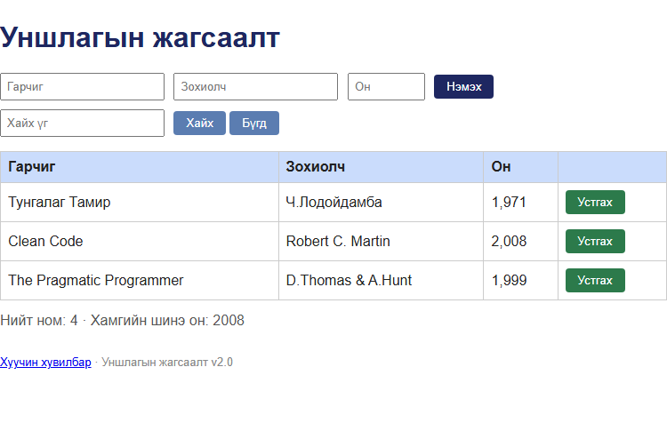

# BUG-02: Хүснэгт номын оныг мянгатын таслалтай харуулдаг

**Орчин** Уншлагын жагсаалт v2.0, Microsoft Edge 158.0.4370.33, Windows 11, 2026-11-25.

**Урьдчилсан нөхцөл** `node app.js`-ийг шинээр асаасан, жагсаалт анхны 3 номтой.

## Дахин гаргах алхам

1. `http://localhost:3000` хаягийг нээнэ.
2. Анхны гурван номын «Он» баганыг дээрээс доош уншина.

**Хүлээгдэж байсан** Он баганад `1971`, `2008`, `1999` гэсэн энгийн тоонууд харагдана.

**Бодит үр дүн** Он баганад `1,971`, `2,008`, `1,999` гэж харагдсан. `GET /api/books` анхны жилүүдийг `1971`, `2008`, `1999` гэж өгсөн.

**Ноцтой байдал** Cosmetic. Жилийн тоон утга зөв ирж байгаа бөгөөд зөрүү нь дэлгэцийн бичилтэд гардаг.

**Олдсон аялал** Supermodel

Edge дээр en-US, mn-MN, de-DE тохиргоог дуурайлгахад гурвууланд нь ижил таслал харагдсан.

## Хавсралт

