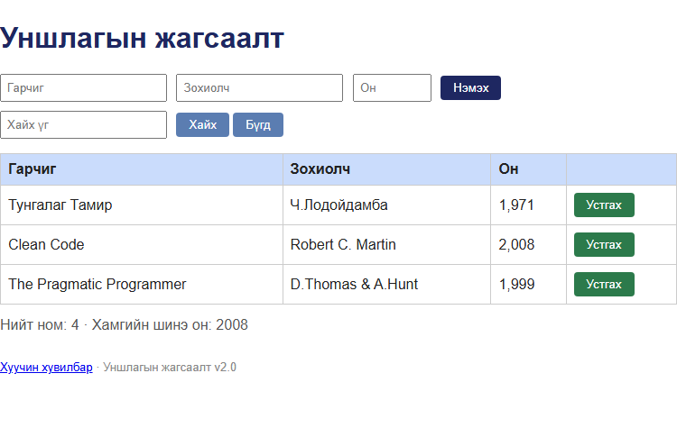

# BUG-03: Номын мөрүүдийн Устгах товч ногоон өнгөтэй

**Орчин** Уншлагын жагсаалт v2.0, Microsoft Edge 158.0.4370.33, Windows 11, 2026-11-25.

**Урьдчилсан нөхцөл** `node app.js`-ийг шинээр асаасан, жагсаалт анхны 3 номтой.

## Дахин гаргах алхам

1. `http://localhost:3000` хаягийг нээнэ.
2. Хүснэгтийн баруун талд байгаа «Устгах» товчнуудын дэвсгэр өнгийг харна.

**Хүлээгдэж байсан** Устгах нь өгөгдөл арилгадаг үйлдэл учраас «Устгах» товч улаан өнгөтэй байна.

**Бодит үр дүн** Гурван «Устгах» товч бүгд ногоон. Браузер дэвсгэр өнгийг `rgb(44, 122, 75)` гэж тооцсон.

**Ноцтой байдал** Minor. Устгах товчны өнгө хэрэглэгчид эрсдэлтэй үйлдлийг даруй танихад туслах ёстой.

**Олдсон аялал** Supermodel

## Хавсралт

