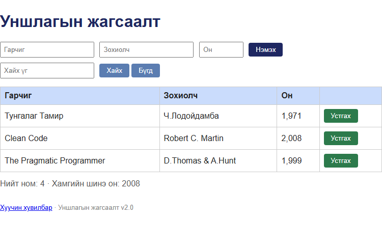

# BUG-04: Нэмэх товчны сүүлийн тэмдэгт латин x байна

**Орчин** Уншлагын жагсаалт v2.0, Microsoft Edge 158.0.4370.33, Windows 11, 2026-11-25.

**Урьдчилсан нөхцөл** `node app.js`-ийг шинээр асаасан, жагсаалт анхны 3 номтой.

## Дахин гаргах алхам

1. `http://localhost:3000` хаягийг нээгээд «Гарчиг», «Зохиолч», «Он» талбаруудын ард байгаа нэмэх товчийг олно.
2. Тэмдэгтийг тулгахын тулд `F12` дарж Console дээр доорх мөрийг бичээд Enter дарна.

   ```js
   document.querySelector('button').textContent.trim().slice(-1).codePointAt(0).toString(16)
   ```

**Хүлээгдэж байсан** Товчны бичвэр кирилл «Нэмэх» байна. Сүүлийн `х` тэмдэгтийн код `U+0445`.

**Бодит үр дүн** Бичвэр «Нэмэx» байсан. Console-д `78` гарсан нь латин `x` буюу `U+0078`.

**Ноцтой байдал** Cosmetic. Товч дарахад ажилладаг бөгөөд зөрүү нь монгол бичвэрийн нэг тэмдэгтэд байна.

**Олдсон аялал** Supermodel

## Хавсралт


