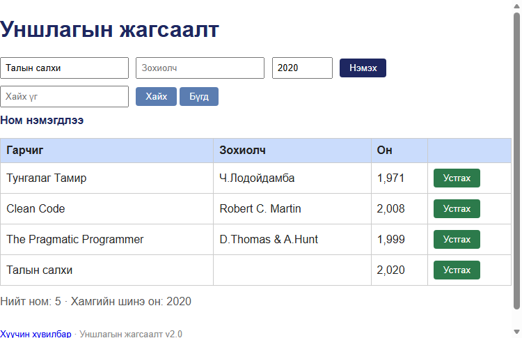

# BUG-05: Зохиолчийг хоосон орхиход ном жагсаалтад нэмэгддэг

**Орчин** Уншлагын жагсаалт v2.0, Microsoft Edge 158.0.4370.33, Windows 11, 2026-11-25.

**Урьдчилсан нөхцөл** `node app.js`-ийг шинээр асаасан, жагсаалт анхны 3 номтой.

## Дахин гаргах алхам

1. `http://localhost:3000` хаягийг нээнэ.
2. «Гарчиг» талбарт `Талын салхи`, «Он» талбарт `2020` оруулна. «Зохиолч»-ийг хоосон орхино.
3. «Нэмэx» товчийг дараад мессеж болон хүснэгтийн сүүлийн мөрийг харна.

**Хүлээгдэж байсан** Гарчиг, зохиолч, он гурвуулаа заавал бөглөгдөнө. Хүснэгт 3 мөртэй хэвээр байж, зохиолчийг бөглөхийг ойлгомжтой мэдэгдэнэ.

**Бодит үр дүн** «Ном нэмэгдлээ» гэж гарч, «Талын салхи» дөрөв дэх мөрөөр орсон. Зохиолчийн нүд хоосон, он `2,020` гэж харагдсан.

**Ноцтой байдал** Major. Үндсэн бүртгэлд дутуу мэдээлэлтэй ном хадгалагдаж, интерфейс амжилттай болсон гэж мэдээлдэг.

**Олдсон аялал** Couch Potato

Session-д гарчиг хоосон үед бас мөр нэмэгдсэн. Он хоосон үлдээхэд оруулсан номын он `0` гэж харагдсан.

## Хавсралт

