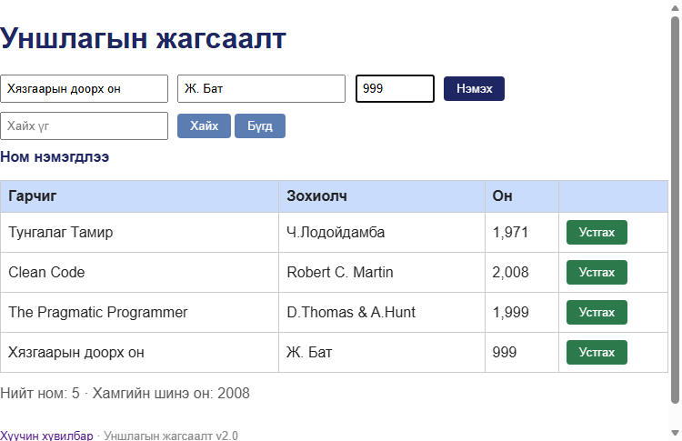
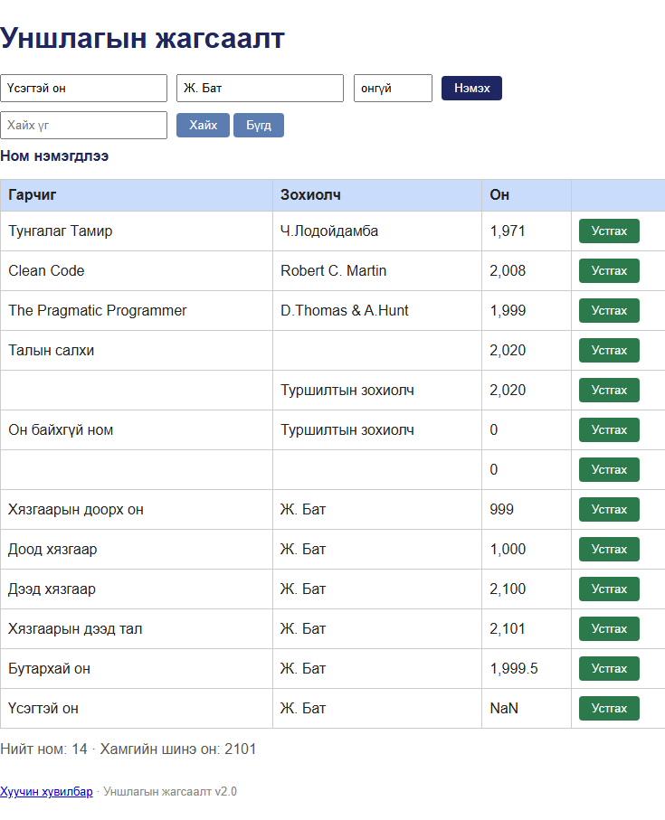

# BUG-06: Зөвшөөрсөн хязгаараас гадуурх 999 оныг номд хадгалдаг

**Орчин** Уншлагын жагсаалт v2.0, Microsoft Edge 158.0.4370.33, Windows 11, 2026-11-25.

**Урьдчилсан нөхцөл** `node app.js`-ийг шинээр асаасан, жагсаалт анхны 3 номтой.

## Дахин гаргах алхам

1. `http://localhost:3000` хаягийг нээнэ.
2. «Гарчиг» талбарт `Хязгаарын доорх он`, «Зохиолч» талбарт `Ж. Бат`, «Он» талбарт `999` оруулна.
3. «Нэмэx» товчийг дарж, мессеж болон шинээр гарсан мөрийг харна.

**Хүлээгдэж байсан** Он нь 1000–2100 хоорондох бүхэл тоо байна. `999` оруулахад хязгаарын тухай алдаа гарч, шинэ мөр нэмэгдэхгүй.

**Бодит үр дүн** «Ном нэмэгдлээ» гэж гарсан. Дөрөв дэх мөрөнд `Хязгаарын доорх он / Ж. Бат / 999` нэмэгдсэн.

**Ноцтой байдал** Major. Зөвшөөрсөн хязгаараас гадуурх жил бүртгэлд орж, жагсаалтын оны мэдээллийг буруу болгодог.

**Олдсон аялал** Couch Potato

Мөн `2101`, `1999.5`, `онгүй` оролтуудыг хүлээж авсан. Сүүлийн жишээ хүснэгтэд `NaN` гэж гарсан.

## Хавсралт

