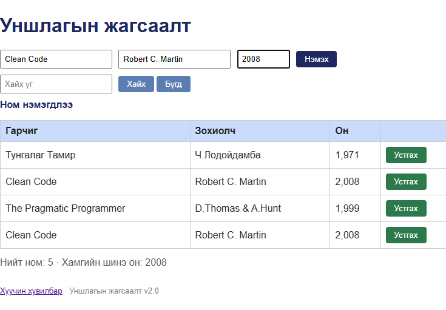

# BUG-07: Ижил гарчиг, зохиолчтой Clean Code ном давхар нэмэгддэг

**Орчин** Уншлагын жагсаалт v2.0, Microsoft Edge 158.0.4370.33, Windows 11, 2026-11-25.

**Урьдчилсан нөхцөл** `node app.js`-ийг шинээр асаасан, жагсаалт анхны 3 номтой.

## Дахин гаргах алхам

1. `http://localhost:3000` хаягийг нээгээд «Clean Code» нэг мөр байгааг харна.
2. «Гарчиг» талбарт `Clean Code`, «Зохиолч» талбарт `Robert C. Martin`, «Он» талбарт `2008` оруулна.
3. «Нэмэx» товчийг дарж, «Clean Code» хэдэн мөр болсон болон гарах мессежийг харна.

**Хүлээгдэж байсан** Ижил гарчиг, зохиолчтой ном дахин нэмэгдэхгүй. Хүснэгтэд «Clean Code / Robert C. Martin» нэг мөртэй байна.

**Бодит үр дүн** «Ном нэмэгдлээ» гэж гарсан. Хүснэгт 4 мөртэй болж, «Clean Code / Robert C. Martin / 2,008» хоёр удаа харагдсан.

**Ноцтой байдал** Major. Нэг ном давхар бүртгэгдэж, хэрэглэгч аль мөрийг анх нэмснээ ялгахад хэцүү болно.

**Олдсон аялал** Couch Potato

Ижил гарчигтай ч өөр зохиолчтой ном нэмэх хяналтын туршилт амжилттай байсан. Ижил гарчиг, зохиолчтой үед оныг `2010` болгон солиход бас давхар мөр нэмэгдсэн.

## Хавсралт

