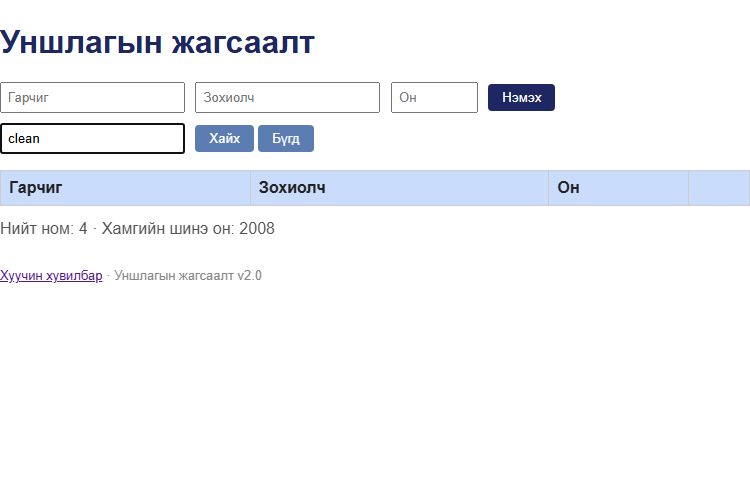
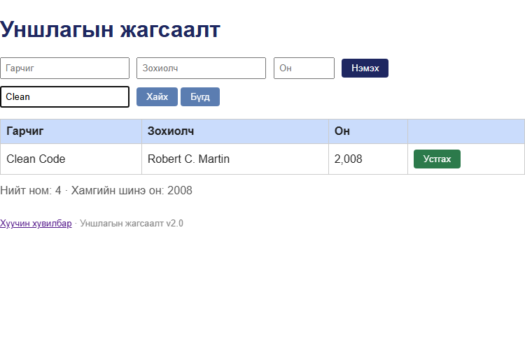

# BUG-08: Ном хайхад гарчиг ба зохиолчийн том жижиг үсэг үр дүнд нөлөөлдөг

**Орчин** Уншлагын жагсаалт v2.0, Microsoft Edge 158.0.4370.33, Windows 11, 2026-11-25.

**Урьдчилсан нөхцөл** `node app.js`-ийг шинээр асаасан, жагсаалт анхны 3 номтой.

## Дахин гаргах алхам

1. `http://localhost:3000` хаягийг нээнэ.
2. «Хайх үг» талбарт `Clean` бичээд «Хайх» товчийг дарна. Харагдсан мөрийг тэмдэглэнэ.
3. Талбарын текстийг `clean` болгож солиод «Хайх» товчийг дахин дарна.
4. Зохиолчоор хайхдаа `Robert`, дараа нь `robert` гэж тус тус оруулаад үр дүнг харьцуулна.

**Хүлээгдэж байсан** Хайлт гарчиг, зохиолчийн аль алинаас том жижиг үсэг ялгахгүй хайна. Дөрвөн хувилбар бүгд «Clean Code» мөрийг олно.

**Бодит үр дүн** `Clean` болон `Robert` тус бүр «Clean Code»-ийг олсон. `clean` болон `robert` тус бүр 0 мөр харуулсан.

**Ноцтой байдал** Major. Хэрэглэгч байгаа номыг үсгийн бичлэгээс шалтгаалаад олохгүй өнгөрнө.

**Олдсон аялал** Fed-Ex

## Хавсралт

