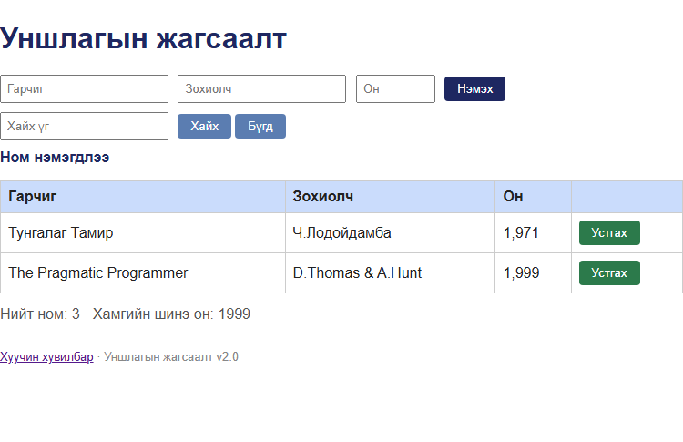

# BUG-09: Ном устгасны дараа Ном нэмэгдлээ гэсэн мессеж гардаг

**Орчин** Уншлагын жагсаалт v2.0, Microsoft Edge 158.0.4370.33, Windows 11, 2026-11-25.

**Урьдчилсан нөхцөл** `node app.js`-ийг шинээр асаасан, жагсаалт анхны 3 номтой.

## Дахин гаргах алхам

1. `http://localhost:3000` хаягийг нээнэ. Ном нэмэх үйлдэл хийхгүй.
2. «Clean Code» мөрийн «Устгах» товчийг дарна.
3. Мөрийн тоо болон хүснэгтийн дээр гарсан мессежийг шалгана.

**Хүлээгдэж байсан** «Clean Code» мөр арилж, устгасныг баталсан мессеж харагдана.

**Бодит үр дүн** «Clean Code» арилж 2 мөр үлдсэн. Үйлдлийн дараах мессеж нь «Ном нэмэгдлээ» байсан.

**Ноцтой байдал** Minor. Устгал хийгдсэн ч интерфейс өөр үйлдэл амжилттай болсон гэж мэдээлж байна.

**Олдсон аялал** Fed-Ex

## Хавсралт

