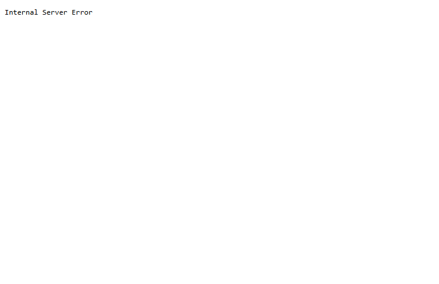

# BUG-10: Хуучин хувилбар холбоос HTTP 500 алдаа өгдөг

**Орчин** Уншлагын жагсаалт v2.0, Microsoft Edge 158.0.4370.33, Windows 11, 2026-11-25.

**Урьдчилсан нөхцөл** `node app.js`-ийг шинээр асаасан, жагсаалт анхны 3 номтой.

## Дахин гаргах алхам

1. `http://localhost:3000` хаягийг нээнэ.
2. Хуудасны доод талд байгаа «Хуучин хувилбар» холбоосыг дарна.
3. Нээгдсэн хуудасны хаяг болон дэлгэц дээрх бичвэрийг харна.

**Хүлээгдэж байсан** «Хуучин хувилбар» холбоосын зорьсон хуудас алдаагүй нээгдэнэ.

**Бодит үр дүн** Браузер `http://localhost:3000/old` руу шилжсэн. Хариу HTTP `500` байсан бөгөөд `Internal Server Error` гэж харагдсан.

**Ноцтой байдал** Minor. Холбоосоор хүрэх хуудас ашиглах боломжгүй. Браузерийн Back-аар үндсэн жагсаалт руу буцаж болсон.

**Олдсон аялал** Supermodel

## Хавсралт

