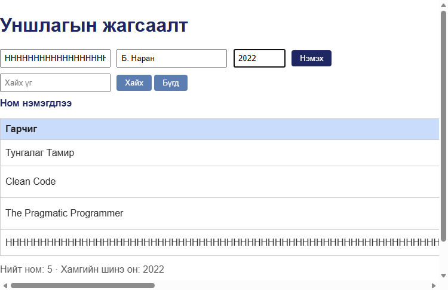
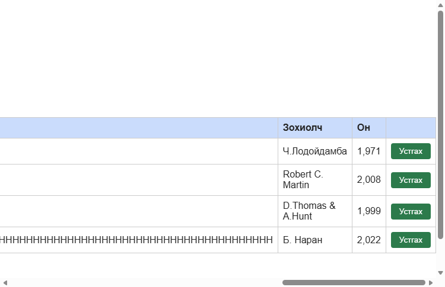

# BUG-11: Зайгүй урт гарчиг хүснэгтийг цонхны хилээс гаргадаг

**Орчин** Уншлагын жагсаалт v2.0, Microsoft Edge 158.0.4370.33, Windows 11, 2026-11-25.

**Урьдчилсан нөхцөл** `node app.js`-ийг шинээр асаасан, жагсаалт анхны 3 номтой.

## Дахин гаргах алхам

1. `http://localhost:3000` хаягийг нээгээд браузерийн агуулгын талбарыг 750 пиксел орчим өргөн болгоно.
2. «Гарчиг» талбарт доорх 160 кирилл `Н` үсгийг нэг мөрөөр, зайгүй хуулж оруулна.

   ```text
   НННННННННННННННННННННННННННННННННННННННННННННННННННННННННННННННННННННННННННННННННННННННННННННННННННННННННННННННННННННННННННННННННННННННННННННННННННННННННННННННН
   ```

3. «Зохиолч» талбарт `Б. Наран`, «Он» талбарт `2022` оруулаад «Нэмэx» товчийг дарна.
4. Хүснэгтийн багануудын байрлал болон доод талд гарсан хэвтээ гүйлгэх мөрийг харна.

**Хүлээгдэж байсан** Урт гарчиг нүдэндээ багтаж, зохиолч, он, устгах товч цонхонд хэвийн харагдана.

**Бодит үр дүн** 750 пикселийн харагдацад хүснэгт ойролцоогоор 2133 пиксел болж тэлсэн. Зохиолч, он, «Устгах» товчийг харахын тулд хуудсыг баруун тийш гүйлгэсэн.

**Ноцтой байдал** Minor. Нэг урт гарчиг бусад мөрийн үйлдэл болон мэдээллийг цонхны харагдах хүрээнээс гаргадаг.

**Олдсон аялал** Supermodel

## Хавсралт




